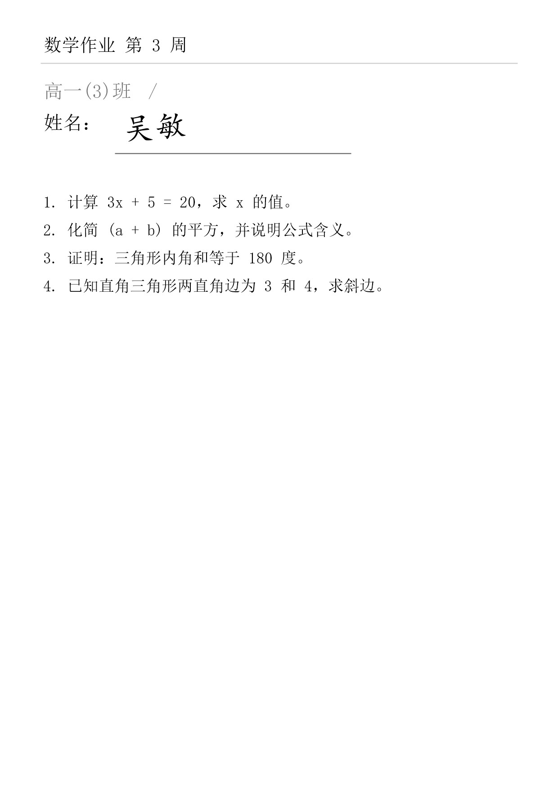

# 学生作业 PDF 按手写姓名自动命名

把一批 `扫描件_001.pdf`、`IMG_2034.pdf`，按学生在纸上**手写**的姓名，重命名成 `张三.pdf`、`李四.pdf`……

批量、本地、可复核、可回滚。Windows 上零依赖开箱即用（用系统自带 OCR，不联网），字迹潦草可以接云端识别或 DeepSeek 视觉模型兜底。

<p>
  
  
  
  
</p>

> **English**: A local tool that renames scanned student assignment PDFs by the **handwritten name** on them.
> Instead of trusting full-page OCR, it crops the name field, matches the result against the class roster
> (closed-set matching), and routes uncertain cases to a review UI instead of guessing.
> Runs offline on Windows using the built-in OCR engine; optional DeepSeek vision fallback for messy handwriting.

---

## 它解决什么问题

老师收上来的作业通常长这样：

```
作业/
├─ 扫描件_001.pdf
├─ 扫描件_002.pdf
├─ IMG_20231012_0003.pdf
└─ ...
```

每一页大概长这样（`samples/` 里的模拟样张，可自己生成）：



跑一遍：

```
$ spn scan 作业/ --roster 班级名单.csv --ocr winocr
[   1/32] OK   张三           scan_001.pdf
[   2/32] 复核 欧阳修         scan_002.pdf
[   3/32] 失败 -             scan_003.pdf
...
完成：共 32 份 · 直接可用 27 · 待复核 4 · 失败 1
```

翻一遍复核页，改掉那 4 个，点一下，得到 `张三.pdf`、`李四.pdf`…… 错了还能一条命令撤回。

---

## 为什么不是「把整页丢给 OCR 然后猜名字」

因为那样做不出来。整页里有标题、正文、批注、日期，通用 OCR 不知道哪个词是姓名；
手写体单字准确率本身就只有 80~95%，再叠加"从一堆字里猜哪个是名字"，结果不可用。

这个需求有个决定性优势：**姓名不是任意字符串，而是你花名册里的几十个人**。
于是问题从「开放集手写识别」变成「闭集匹配」：

```
                  ┌─ 文字层有文字？ ── 有 ──┐
PDF ──► 第 1 页 ──┤                        ├─► 候选行 ──► 切 2~4 字滑窗
                  └─ 没有 ──► 裁姓名区 ──► OCR ──┘                    │
                                                                      ▼
         花名册 ────────────────────────────────► 闭集匹配（字形+形近字+拼音）
                                                                      │
                            ┌─────────────────────────────────────────┤
                            ▼                    ▼                    ▼
                          ok (≥0.80)        review (0.58~0.80)      fail (<0.58)
                            │                    │                    │
                            └────► plan.json ◄───┘                    │
                                       │                             ▼
                                 复核页 / 网页 ◄────────── 人工确认或点击候选
                                       │
                                       ▼
                              apply（默认只预览）──► 重命名/复制 ──► manifest.jsonl ──► rollback
```

一句话：**OCR 只要认得"像"，就能被吸附到正确的那个人；实在不像就明确说"我不确定"。**

---

## 快速开始

### 30 秒看效果（Windows）

```bash
git clone https://github.com/your-name/student-pdf-namer.git
cd student-pdf-namer

python -m spn serve --demo
```

浏览器打开 <http://127.0.0.1:8765>，点「载入示例（8 份）」——会自动上传、框选姓名区域、识别、列表格。
也可以在地址后面加 `?demo=1` 直接跑完。

> 没有 Python？装一个 3.11+ 即可，其余什么都不用装。

### 用自己的文件

```bash
python -m spn serve
```

1. 拖入 PDF（可多选，随时增删，缩略图实时渲染）
2. 左边粘贴班级名单（每行一个姓名）
3. 点「开始识别」——第一次会弹出框选窗口，姓名那一行通常已经自动框好，直接确认
4. 结果表里改名字，**点候选标签可一键填入**
5. 「生成压缩包」→ 拿到 `张三.pdf`、`李四.pdf`……

### 命令行（批量、可回滚）

```bash
spn scan 作业/ --roster 名单.csv --out out --ocr winocr --region 0.074,0.122,0.632,0.200
spn apply out/plan.json --include-review          # 只预览
spn apply out/plan.json --include-review --yes    # 真执行
spn rollback out/manifest.jsonl --yes             # 后悔了
```

安装成命令（可选）：

```bash
pip install -e .
spn --help
```

---

## 功能

| | |
| --- | --- |
| **三态判定** | `ok / review / fail`。失败项**绝不**套用"最佳猜测"，宁可让你手填 |
| **闭集匹配** | 编辑距离 + 形近字代价（未/末、己/已）+ 拼音兜底 + margin 防「张三/张山」互串 |
| **本地离线** | Windows 自带 `Windows.Data.Pdf` + `Windows.Media.Ocr`，零依赖、文件不出本机 |
| **多后端** | `winocr` / 百度手写 / PaddleOCR / PDF 文字层 / 旁车 JSON |
| **视觉兜底** | 只把没认准的姓名区截图交给 `deepseek-flash`，输出仍走名单匹配 |
| **网页复核** | 缩略图管理、拖框选区域、点候选填入、导出 zip |
| **可回滚** | 每步写 `manifest.jsonl`，`rollback` 一条命令撤销 |
| **不破坏原文件** | 默认 `copy` 模式；`rename` 需显式指定 |

---

## 识别后端怎么选

| 方案 | 手写准确率 | 成本 | 数据出网 | 说明 |
| --- | --- | --- | --- | --- |
| **Windows 自带 OCR** | 工整字可用，连笔一般 | 免费 | 否 | 默认。零安装，Windows 10/11 + 中文语言包 |
| **DeepSeek `deepseek-flash`** | 连笔/花体明显更强 | ≈0.1 分/张 | 是 | 只用来救没认准的件 |
| 百度「手写文字识别」 | 高 | 按次计费 | 是 | 中文手写第一梯队 |
| PaddleOCR | 印刷体强，手写一般 | 免费 | 否 | 隐私敏感、量大 |
| 自训模型（TrOCR/SVTR） | 数据够时最高 | 训练成本 | 否 | 字迹固定、长期使用 |

**推荐级联**：文字层 → 本机 OCR →（仅没认准的）视觉模型兜底 → 人工复核。
实测 8 份样本里只有 1 份触发了兜底调用。

### 开启视觉兜底

```bash
set DEEPSEEK_API_KEY=sk-xxxx          # macOS/Linux: export ...
spn scan 作业/ --roster 名单.csv --vision auto
```

网页版勾选「用 DeepSeek 视觉模型再读一遍」即可，Key 也能直接填在页面上（只存内存）。

设计上有一条硬约束：**模型只负责认字，不负责决定是谁**。它输出的文字会被当成一条额外的
OCR 结果，仍然走花名册匹配——所以模型再自信也不能把张三写成名单外的人，最多把 `fail` 抬成 `review`。

> 注意：`deepseek-flash` 支持视觉，`deepseek-v4-pro` 不支持。
> 详见 [Vision 指南](https://api-docs.deepseek.com/guides/vision)。

想接私有部署（vLLM 跑 DeepSeek-VL2、或自建代理）只要改 `DEEPSEEK_BASE_URL`。

---

## 姓名区域：不用手填坐标

坐标是页面比例，但你不需要算。三种方式：

1. **自动定位**：网页打开框选窗口时先整页 OCR 一遍，含名单姓名或「姓名」二字的行会自动框好；
2. **手拖**：在页面图上按住鼠标拉一个框，实时显示 `0.074,0.122,0.632,0.200`；
3. **手填**：命令行 `--region x0,y0,x1,y1`。

**框要多留余量**——这是最容易踩的坑。自动定位拿到的是紧贴这一份文件的行框，
而「张三」和「欧阳修」宽度差一截，照抄会把长名字裁掉。所以工具会自动往右多留 30% 页宽、
上下各放 0.6 个行高；手拖时也建议**从「姓名」左边一点起，拉到明显超过名字末端**。

框小了会丢字，框大了只会多认几个无关字（不影响匹配）。

---

## 准确率与调参

```toml
[match]
ok_threshold = 0.80          # 大于等于它且领先次选 -> 直接命名
review_threshold = 0.58      # 整页识别时的复核下限
review_threshold_roi = 0.48  # 框了姓名区域时的复核下限（噪声低，可放宽）
min_margin = 0.08            # 与次选的差距，防「张三/张山」
```

正确做法：先只跑 30~50 份，看复核页里每个判断，再定阈值。
目标不是"全自动"，而是**人工复核量占 10~20%**，且复核项里 80% 是真该看的。

一个具体例子：`吴敏` 被本机 OCR 读成 `夹敏`，字符相似度 0.5。

- 整页模式阈值 0.58 → 判失败（正文里太多字会刷出假候选，不能放宽）；
- 框了区域后阈值降到 0.48 → 进复核，并把 `吴敏 0.50` 作为候选给你点。

---

## 已知局限

- **连笔、竖排、艺术字**：本机 OCR 会大量落到 fail，需要换云端或视觉模型。
- **名单外的人**（转学生、代交）：必然判 fail —— 这是期望行为。
- **同名同姓**：两人分数会非常接近，margin 会把这类统统丢进复核，不会随机挑一个。
- **一块作业多个姓名**（小组作业）：当前只取"最像的那个"。
- **繁体/异体字**：未做简繁归一。
- **字体识别**：Windows OCR 的准确率与字迹工整度强相关；这套工具靠"裁区域 + 闭集"扛噪声，
  不是靠模型本身。

---

## 项目结构

```
spn/
├─ web.py / web_page.py   # 本地网页应用（不含构建步骤，HTML/CSS/JS 内联）
├─ winocr.py              # Windows 自带 PDF 渲染 + 中文 OCR（+ 多尺度合并）
├─ win_pdf_ocr.ps1        # 上面那个模块调用的 PowerShell 桥
├─ vision.py              # DeepSeek 视觉兜底
├─ sources.py             # 其它 OCR 后端（百度 / PaddleOCR / 文字层 / JSON）
├─ text.py                # 归一化 + 2~4 字滑窗候选
├─ similarity.py          # 编辑距离、形近字、拼音
├─ roster.py / match.py   # 花名册与闭集匹配
├─ naming.py / plan.py    # 命名规则、计划落盘
├─ apply.py               # 执行 + manifest 回滚
├─ pipeline.py            # 编排
└─ report.py              # 离线复核页
tools/                    # 样例生成、假视觉接口、端到端自检
samples/                  # 8 份模拟扫描件 + 名单（--demo 用）
tests/                    # 27 个单元测试
```

---

## 开发

```bash
python -m unittest discover -s tests -v        # 27 个测试，零依赖
python tools/smoke_web.py                      # 起临时服务跑完整链路
python tools/make_sample_pdfs.py --count 5     # 生成模拟扫描件（Windows）
python tools/mock_vision.py --port 8799        # 无 Key 时验证视觉链路
```

测试覆盖：匹配与歧义、形近字、命名清洗、计划/执行/回滚、视觉客户端与降级，
以及网页 API 的端到端流程。

欢迎提 issue / PR。如果这个工具帮你省下了一晚上的改名时间，点个 star 就是最好的回报。

---

## 许可证

[MIT](LICENSE)
